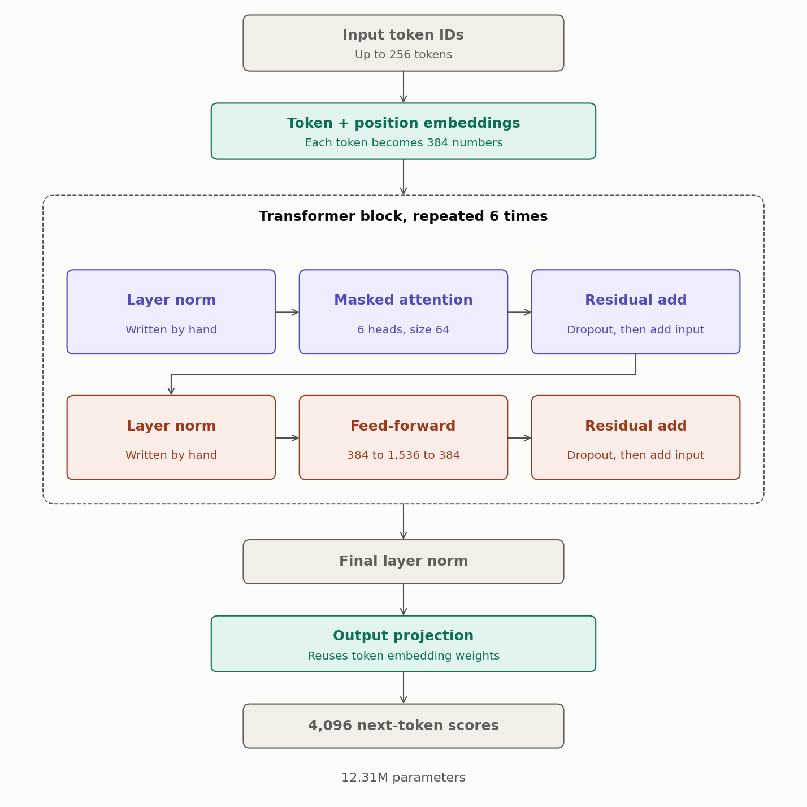
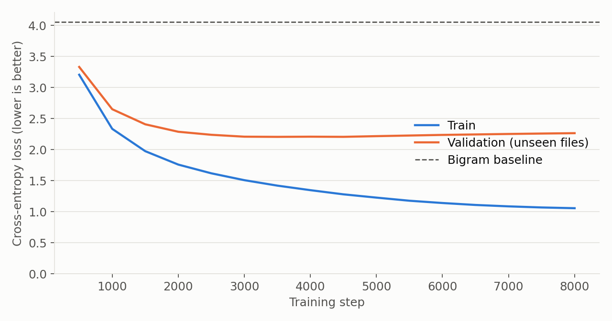
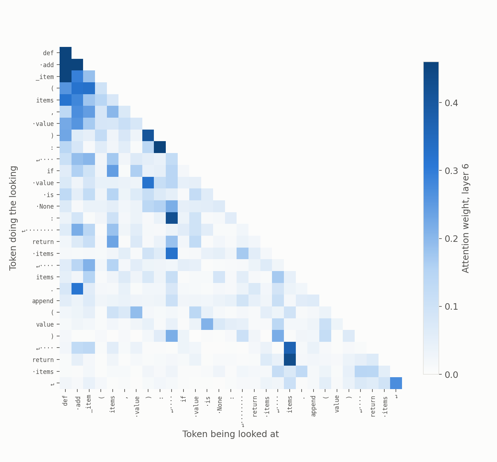
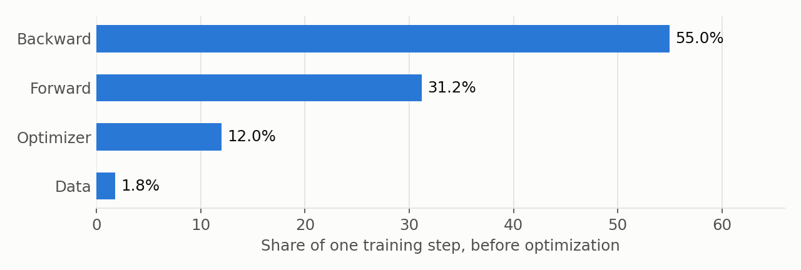
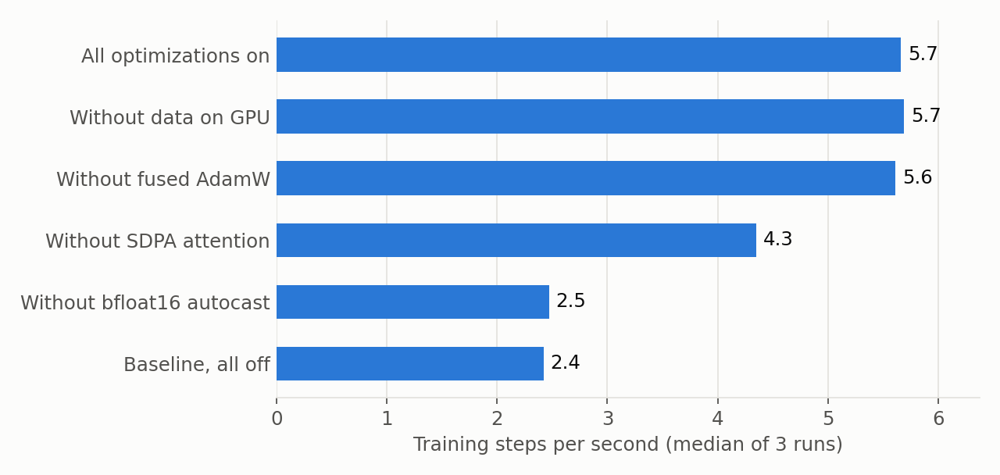
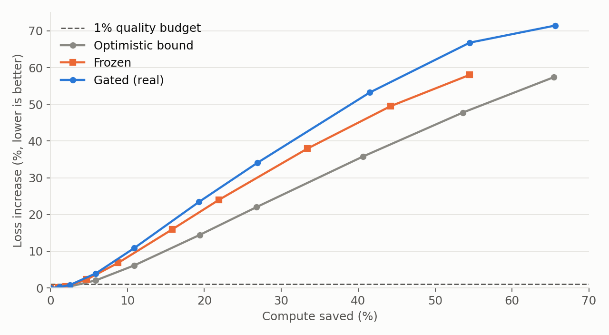
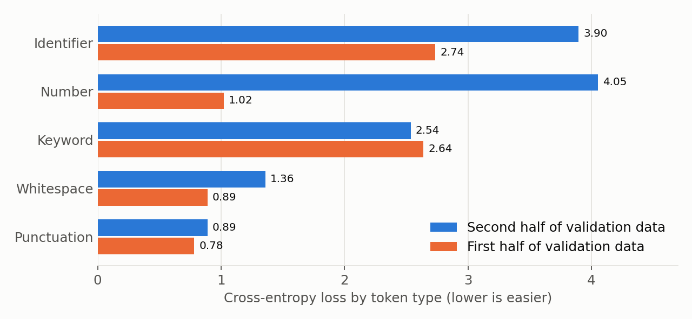

# Transformer from scratch, measured honestly

A 12.31M-parameter GPT-style Transformer, written by hand and trained on Python source code. It
comes with profiling, an ablation, a code-quality eval, and a preregistered test of per-token early exit.

**This is not a state-of-the-art model.** It is a study in building, testing and measuring one
properly, including the results that did not go my way.

**[Watch the 98-second narrated walkthrough](results/how_it_works.mp4)**, or [explore the model's attention](docs/attention_explorer.html) (download the file and open it in a browser).


## Key results

| Question | Result |
|---|---|
| Does it learn? | Validation loss **2.205** on unseen files, against 4.056 for a bigram baseline |
| Can training be made faster? | **2.3x** faster, from 2.42 to 5.66 steps per second |
| What drove the speedup? | bfloat16 and SDPA attention. Moving data to the GPU and fused AdamW made no measurable difference |
| Does it write valid Python? | Barely: **1.0%** of samples were a valid complete function, against 0% for bigram |
| Can easy tokens exit early? | **No, not on this model:** 0.0% compute saved, and 1.8% with the validation halves swapped |

## Architecture



## What is written by hand

- Masked multi-head attention, with a second SDPA backend tested to agree with it
- Layer normalization, tested against PyTorch
- KV cache for generation, tested to match a full forward pass
- A byte-level BPE tokenizer that keeps newlines and indentation together
- Weight tying, residual scaling at init, training loop, resume and sampling

`nn.Linear`, `nn.Embedding` and `AdamW` come from PyTorch. See the [design doc](docs/DESIGN.md).

## Training



| | |
|---|---|
| Data | Python 3.12.4 standard library: 490 training files and 46 unseen validation files |
| Tokens | 3.09M training tokens, 4,096-token vocabulary |
| Model | 6 layers, 6 heads, 384 dimensions, 256-token context |
| Best checkpoint | Step 3,500 of 8,000 |

Overfitting is visible: training loss keeps falling to 1.06 while validation loss bottoms out at
2.205 and rises to 2.26. 3.09M tokens is small for this model, so the best checkpoint is the one used.

## What the model attends to



Real weights from the final layer of the trained model, averaged over 6 heads, for a short Python
function. Everything above the diagonal is empty because the mask hides future tokens. The
[attention explorer](docs/attention_explorer.html) lets you pick any token and layer.

## Speed





Median of 3 runs of 150 steps, at batch size 64, on an RTX 5060 Laptop GPU.

| Change | Steps per second | Peak GPU memory |
|---|---|---|
| Baseline, hand-written attention in float32 | 2.42 | 5,505 MB |
| All changes on | 5.66 | 2,889 MB |
| Without bfloat16 | 2.47 | 4,013 MB |
| Without SDPA attention | 4.35 | 4,034 MB |
| Without fused AdamW | 5.61 | 2,889 MB |
| Without data on the GPU | 5.69 | 2,866 MB |

**Profiling changed the plan.** I expected data loading to be a bottleneck, but it took under 2% of
each step, and backward took 55%. Removing each change in turn, instead of only adding them, avoids
crediting whichever change happened to come first.

**Known measurement problems:**

- `torch.compile` was dropped, because it needs Triton on the GPU, which was unavailable on this Windows setup.
- Generation timing is unreliable here. Steps often took about 30 ms whatever the workload, so the
  benchmark shows no KV cache speedup: 490 to 534 tokens per second at batch 16, cached or not. One
  run did show a large gain, but it did not reproduce. The cache is proven correct by tests, but
  its speed benefit is **not established**. The cause of the floor is unknown.
- Profiling did find one real bug: `torch.multinomial` measured about 16x slower on bfloat16 than float32 (21 ms
  against 1.3 ms), so sampling now uses float32.

## Does it write valid Python?

500 samples from the prompt `def `, 200 new tokens each. A sample counts only if its first function
finishes and parses with `ast.parse`.

| Model | Temperature | Finished | Valid | Valid multi-line | Copied from training data |
|---|---|---|---|---|---|
| Transformer | 0.5 | 9.4% | 0.0% | 0 | 0 |
| Transformer | 0.8 | 28.2% | 0.8% | 2 | 0 |
| Transformer | 1.0 | 37.6% | 1.0% | 3 | 0 |
| Bigram | 0.8 | 67.8% | 0.0% | 0 | 0 |

The output looks like Python, but it is rarely correct Python. Syntax is also a low bar: this eval
says nothing about whether the code is useful.

## Early-exit study

**Question:** can predictable tokens leave the network early at equal quality, and save compute?
The hypothesis, metric and decision rule were [written down before the first run](docs/PREREGISTRATION.md).
Per-token early exit is [an active field](docs/RELATED_WORK.md), so this is a measurement on code, not a new architecture.

**Result: stop.** Saving under 30% meant stop, and the learned gate saved 0.0%.

Compute saved and loss increase on held-out data, with each threshold chosen on the other half:

| Exit signal | Mode | Saved | Loss increase | Swapped: saved | Swapped: loss increase |
|---|---|---|---|---|---|
| **Learned gate** | **Gated (primary)** | **0.0%** | **0.0%** | 1.8% | 0.81% |
| Learned gate | Frozen | 1.0% | 0.13% | 6.0% | 6.46% |
| Learned gate | Optimistic bound | 1.2% | 0.13% | 27.8% | 44.48% |
| Convergence | Gated | 2.1% | 3.49% | 2.3% | 4.84% |
| Convergence | Frozen | 9.4% | 11.79% | 21.3% | 38.94% |
| Softmax confidence | Gated | -67.3% | 0.0% | -62.0% | 0.48% |

Modes: **gated** removes exited tokens from deeper context. **Frozen** stops updating them but keeps
them visible. **Optimistic** assumes they cost nothing and stay visible, which is impossible in practice.



Saving compute costs quality almost immediately, even in the optimistic case. Only the first
few percent of savings stay near the 1% budget, and this chart shows held-out data only.



**What I learned:**

- The tuning data did not predict the held-out data. Quality limits met during tuning were broken
  on held-out data in several runs, because the two halves differ (loss 1.79 against 2.57). A
  position split was a weak choice, and files should be stratified next time.
- Softmax confidence costs far more than it saves here. Each check needs a full output projection,
  which costs about as much as a Transformer block.
- Secondary predictions held up, but one was tiny: whitespace and punctuation exited slightly earlier
  than identifiers (5.76 and 5.85 layers against 5.99).
- Token types differ widely in difficulty. Identifiers are about half of all tokens and are by far the
  hardest common type, at a loss of 3.90 against 0.89 for punctuation.

**Limits:** this is one 6-layer model, one seed, and layers not retrained for gating. It says nothing
about large models, where published work finds more savings.

## Reproduce it

```bash
pip install torch numpy matplotlib pillow pytest
python reproduce.py
```

This runs the tests, builds the dataset, trains, and regenerates every result and chart. It needs a
CUDA GPU. Use `python reproduce.py --from eval` to skip finished steps. Results will differ if your
Python version has a different standard library. Each JSON file in `results/` records its software and hardware.

`--swap` on `early_exit.py` reproduces the swapped-halves check. That one is not part of `reproduce.py`.

## Tests

47 tests cover the failures that usually break a Transformer silently, including future-token
leakage, KV cache drift, tokenizer round trips, exact resume, and the compute accounting.

```bash
python -m pytest -q
```

## Layout

| Path | Contents |
|---|---|
| `tfs/` | Model, tokenizer, data sampling and result tracking |
| `train.py`, `sample.py` | Training and generation |
| `benchmark.py` | Profiling and ablation |
| `eval_code.py` | Python validity eval |
| `early_exit.py` | Early-exit study |
| `plot.py`, `visualize.py` | Charts, architecture diagram and attention views |
| `make_video.py` | Narrated walkthrough. Needs ffmpeg, and the voice needs Windows |
| `docs/` | Design doc, preregistration, related work and attention explorer |
